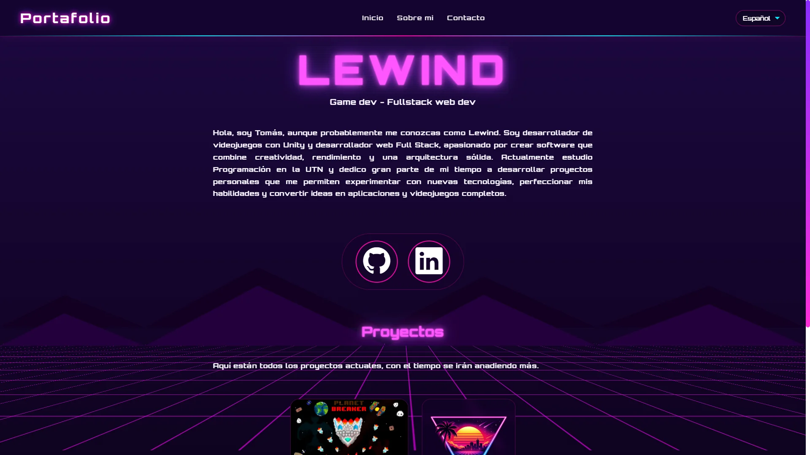
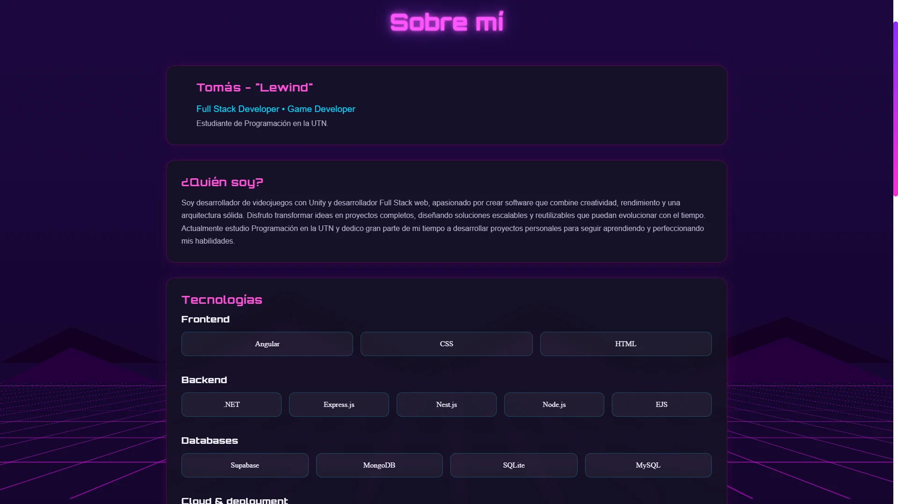
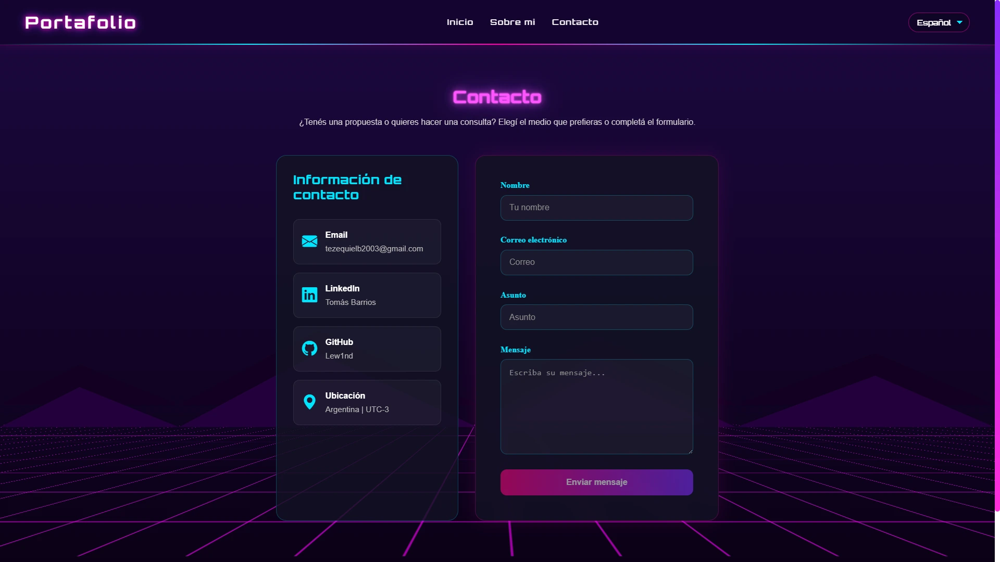
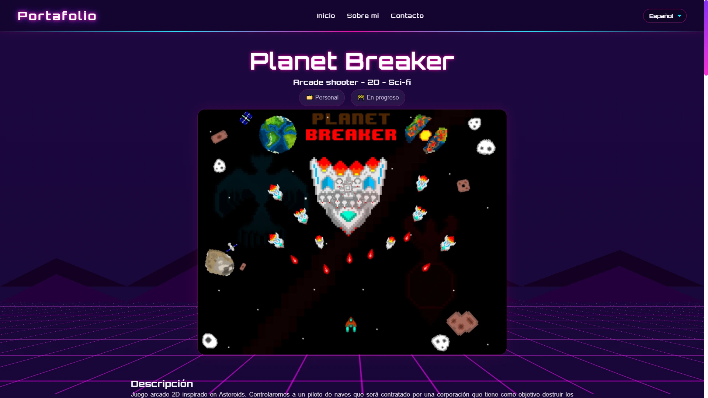
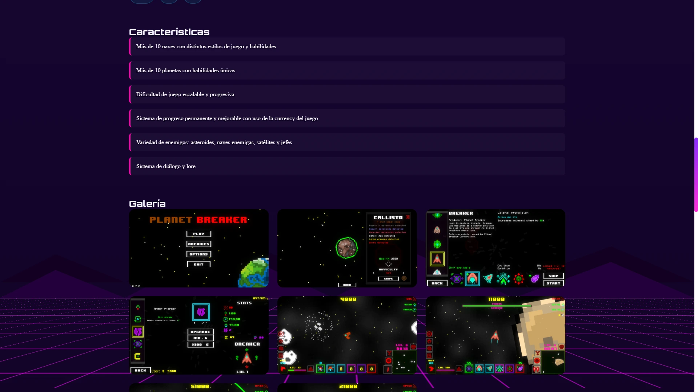

# Lew1nd — Portfolio


Personal portfolio built with **Angular and TypeScript**, showcasing my projects, technical skills, and software development experience.

**[Live Demo](https://lew1nd.github.io/Portfolio/)** · **[GitHub Repository](https://github.com/Lew1nd/Portfolio)**

## Preview

Explore the portfolio interface and its visual design.











## Tech Stack

- **Framework:** Angular 21
- **Language:** TypeScript
- **Frontend:** HTML5, CSS3
- **Internationalization:** ngx-translate
- **Icons:** Bootstrap Icons
- **Contact Form:** EmailJS
- **Reactive Programming:** RxJS
- **Testing:** Vitest
- **Code Formatting:** Prettier
- **Deployment:** GitHub Pages
- **CI/CD:** GitHub Actions
- **Version Control:** Git, GitHub

## Features

- Responsive interface for desktop and mobile devices.
- Project showcase with dedicated visual previews.
- Multilingual support using ngx-translate.
- Contact form integration with EmailJS.
- Angular routing for navigation between sections.
- Automated deployment to GitHub Pages using GitHub Actions.

## Getting Started

### Prerequisites

- Node.js compatible with Angular 21.
- npm.

### Installation

1. Clone the repository:

   ```bash
   git clone https://github.com/Lew1nd/Portfolio.git
   ```

2. Navigate to the project directory:

   ```bash
   cd Portfolio
   ```

3. Install the dependencies:

   ```bash
   npm install
   ```

4. Start the development server:

   ```bash
   npm start
   ```

5. Open the local URL displayed in the terminal, usually `http://localhost:4200/`.

### Available Scripts

| Command | Description |
| --- | --- |
| `npm start` | Starts the Angular development server. |
| `npm run build` | Builds the application for production. |
| `npm run watch` | Rebuilds the application when files change, using the development configuration. |
| `npm test` | Runs the project's test suite. |

## Deployment

The portfolio is hosted on **GitHub Pages**.

The project uses GitHub Actions to build the Angular application and deploy the generated static files.

Visit the deployed application:

**[https://lew1nd.github.io/Portfolio/](https://lew1nd.github.io/Portfolio/)**

Feel free to explore my portfolio and get in touch through the contact form.

---

## License

All rights reserved. This project is not open source.
Unauthorized copying, modification, distribution, or reuse of this code is prohibited.

Developed by **Lew1nd**.
